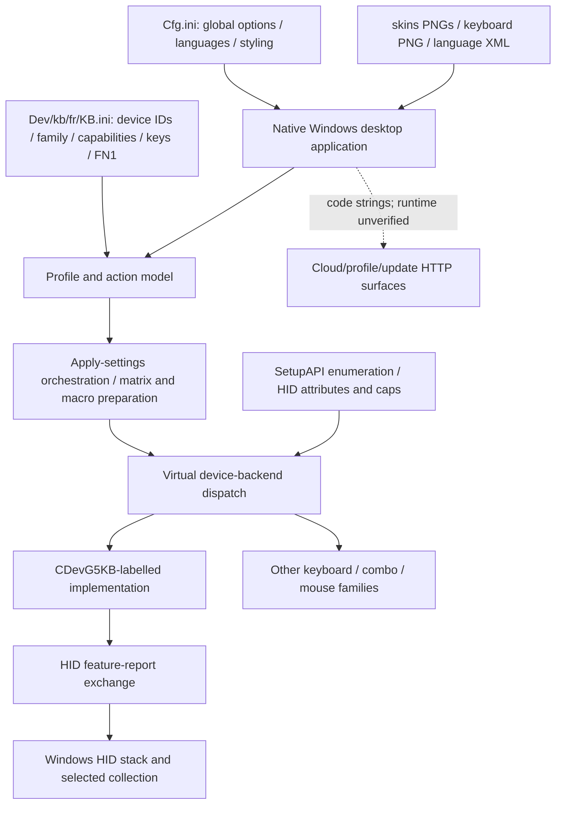

# Official application: static architecture and code map

## Scope and provenance

This is a first-pass understanding of the installed official software, not a completed wire-protocol specification. Target: `C:/Program Files (x86)/AULA/F75/OemDrv.exe`, SHA-256 `1dfe4803efdbe14f66680f970a6d6f26108342fd49754234fa448dd0ebae44a7`. Native x86 PE, image base `0x400000`; Ghidra 12.1.4 default analysis previously reported 14,866 procedures and 4,327 defined strings. Function names `FUN_...` are synthetic. `CDev...` labels below come from diagnostics/RTTI, not recovered original source.

Machine-readable REA Evidence, including complete selected pseudocode, arguments, profile digest and limitations: [rea-static-evidence.json](evidence/rea-static-evidence.json). Installed-file inventory: [installed-inventory.json](evidence/installed-inventory.json). Installed source files were not changed or executed. No device commands were sent.

## Architecture derived from inspected artifacts

Edges summarize inspected code and artifacts; they are not a fully recovered startup call graph. In particular the backend factory, every virtual dispatch target, persistence paths and all UI handlers remain unresolved.

## Configuration-to-code linkage

### Global options: `0x40ea80`

An xref from `%sCfg.ini` at `0x60e7d4` resolves into this loader. It uses `GetPrivateProfileIntW` / `GetPrivateProfileStringW` on `[OPT]`, including `Title`, `Ver`, `appdir`, `ApplyNow`, `EnableYun`, `UpdateByLocal`, `MacLayout`, colors and languages. Observed defaults include `ApplyNow=0`, `EnableYun=0`, `UpdateByLocal=1`, `GoWithNoDev=0`; the installed file overrides some defaults. `LangN` entries are split at a comma. This confirms these resources are read by code rather than merely unused files. The final Appdir-derived storage location has not been recovered.

### Keyboard options: `0x411830`

`MatrixLen` string at `0x60f8e0` has an xref at `0x4122ff` inside this loader. Code reads UI/hardware translation tables `SleepUI/SleepHW`, `Speed/SpeedHW`, `Light/LightHW`; `MatrixLen` default `0x80`; `CRC` default 1; numerous masks and feature flags; optional firmware-update thresholds; RGB ordering and effect options. This supports a generic configurable engine with per-device capabilities. It does not by itself identify every tuple field or prove active hardware support.

### Layer/action parsers: `0x413830`, `0x459ef0`

Both were reached through `%s\\KB.ini` xrefs. `0x413830` reads `K%d` entries from a caller-selected section, tokenizes comma-separated values, requires `0x`-prefixed hex action values, and branches on action type (including modifier-specific handling). This supports separating the UI hit-box/key metadata from alternate-layer typed action records. The complete matrix serializer and the relation between virtual-key values, matrix indices and firmware usages still need recovery; do not send INI tuples directly to the device.

Evidence: batch `ev_1e76ad8ec8e70dc647db0450bfb3d9c53d66d9f2fc2161afa39d04ea01b38dd7`; profile-loader batch `ev_31a2ec1c4fd73642f997f64de7bf1ac9eeb334bc616074be43e90b0a2de986ca`.

## Device discovery and backend distinction

### Enumeration: `0x4171d0`

Obtains interface paths with `SetupDiGetDeviceInterfaceDetailW`, opens candidates with `CreateFileW`, calls `HidD_GetPreparsedData`, `HidD_GetAttributes`, `HidP_GetCaps`, and records capabilities plus VID/PID into a global inventory. Discovery closes its temporary handle. These are observations of target code, not API calls executed against the keyboard by this investigation.

### G5 keyboard finder: `0x498fb0`

Matches configured VID/PID against that inventory. For its family field equal to `0x18`, the inspected branch requires **UsagePage `0xff00`, Usage `1`, feature-report length `0x208` (520 bytes)**. Mapping the stored fields is derived from the enumeration function's writes and standard HID_CAPS field order. Another branch handles family `0x1a`; do not conflate the two.

The installed profile has `Fw=24` (`0x18`) and wired IDs `258A:010C`. Present PnP observations independently contain `258A:010C`, making this the strongest current software/hardware match. However, assignment of the INI Fw value to this exact family field and the backend factory/vtable selection have not been traced end-to-end. The finder/backends are therefore a strong lead, **not yet a live verified backend selection**. Report length/usage values have not been queried from the live report descriptor.

The finder may call `0x49a430` to obtain six bytes compared with profile `Psd`; the purpose is an identity/compatibility gate in this code, not established cryptographic authentication. Its packet semantics and failure behavior require analysis before use. Discovery in the original app can itself exchange commands; merely launching it is not assumed passive.

Diagnostics/RTTI also reveal `CDev3632`, `CDev916KB`, `CDevComboFilm`, and `CDevG5MS`. `0x40c560` explicitly constructs a `CDevG5MS`-labelled mouse watcher. This confirms substantial generic/shared code. Mouse checksum behavior and screen/GIF routines must not automatically be applied to the F75.

Evidence: finder/profile batch `ev_31a2ec1c4fd73642f997f64de7bf1ac9eeb334bc616074be43e90b0a2de986ca`; enumeration and backend wrappers are in the preserved backend batch.

## Applying settings: `0x49c020`

This large `CDevG5KB::ApplySetting`-labelled orchestration function accepts a flag mask, uses a profile/device model and virtual methods, and contains matrix preparation (`FillMatrix`, `Matrix (Save)`), macro dirty/write tracking, layer loops, LED RGB table writes, configuration saving diagnostics and completion/error paths. `param_4 & 1` gates a matrix-oriented branch; other masks gate additional operations. Exact mask contracts and virtual method mapping are incomplete.

This is not evidence that changing one UI slider sends only one small command. A replacement UI must understand dirty-state, coupled writes and persistent-save boundaries before reproducing Apply. “Save” diagnostics alone do not distinguish host profile persistence from device nonvolatile storage.

Transport call sites provide initial selector leads:

| Address | Code observation | Status |
|---|---|---|
| `0x499600` | G5KB transport with operation 1, selector 3, caller secondary selector | Semantics unknown |
| `0x499850` | operation 1, selector 5; failure text `SetMacro failed` | Macro-related static lead; encoding unknown |
| `0x49a7b0` | operation 1, selector 8 with a state gate | Unknown; not a safe test command |
| `0x49cfd0` | selector `0x0d`; `SetGIFParam` diagnostics and packed parameters | Generic code; F75 applicability unproven |

These are analysis landmarks, not a sendable command catalog. Incomplete recovered register arguments and virtual delegation make direct transplantation unsafe. See [hid-transport.md](hid-transport.md).

## Network/update surfaces

Defined executable strings include `http://120.79.152.79/update/` at `0x61b8c8`, and HTTP templates for logon/register/password change/profile download/delete/upload/macro submission. These are **static literals**, not observed connections; no requests were made. Global `EnableYun=0` is configured, but neither that flag nor a dormant string proves the absence/presence of all network activity. Update package validation, endpoint construction, credential handling and TLS behavior remain unexamined. Retain offline analysis and do not follow embedded URLs automatically.

Evidence: string search `ev_103073a415b3873fdf3473ef55d749c8e70d9434eed51944a46be121022cc67e`.

## Critical next code landmarks

1. Trace backend factory and profile VID/PID/Fw initialization to verify actual F75 dispatch.
2. Resolve the G5KB vtable, matrix/macro/LED getters/setters and Apply flag contracts.
3. Recover `0x49a430` identity query and its response checks without issuing it.
4. Confirm wire header from assembly and report descriptor; decompiler locals/registers are not trustworthy ABI declarations.
5. Locate host profile import/export/storage and device persistent-save commands separately.

The current evidence is sufficient to focus the next reverse-engineering pass; it is not sufficient to implement safe hardware writes.
